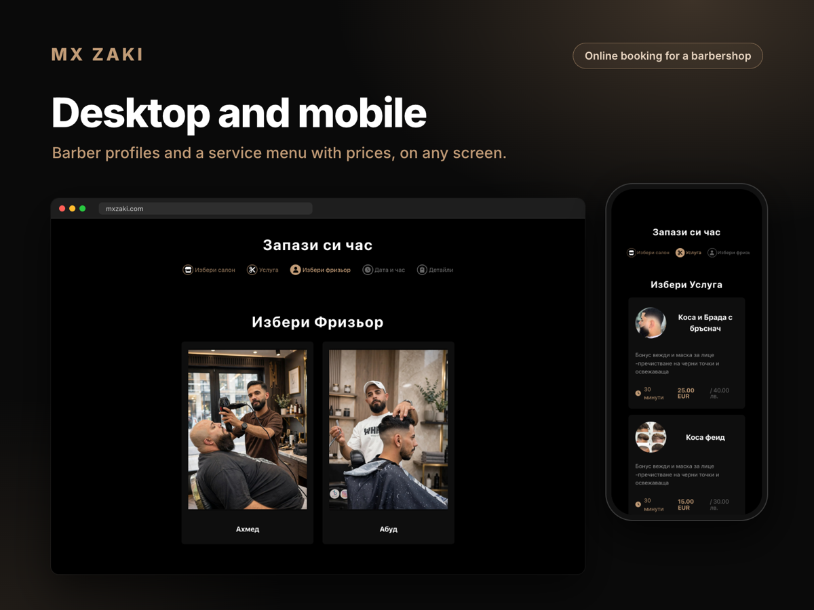

# MX Zaki booking

Online booking for [MX Zaki](https://mxzaki.com), a barbershop in Sofia. Customers pick a salon, a service, a barber and a time slot; staff see new bookings appear in their admin calendar straight away.



Live at **[mxzaki.com](https://mxzaki.com)** since 2025.

## What it does

**For customers**
- Step-by-step booking: salon → service → barber → date and time → contact details → summary
- Only free slots are offered, based on each barber's hours, days off and existing appointments
- Prices shown in EUR and BGN

**For the shop**
- Admin calendar with every appointment, updated live over Socket.IO
- Manage salons, barbers (with photos), services and prices
- Each booking is also added to the barber's Google Calendar

## Stack

| Part | Tech |
|---|---|
| Client | React 19, TypeScript, Vite, styled-components, react-big-calendar |
| Server | Node.js, Express 5, TypeScript, MongoDB (Mongoose), Socket.IO, JWT auth |
| Integrations | Google Calendar API, AWS S3 for photos |
| Deployment | Vercel (client), Docker (server) |

## Run locally

```bash
# server
cd Server
cp .env.example .env   # fill in MongoDB and Google OAuth; also set JWT_SECRET, ADMIN_EMAIL, ADMIN_PASSWORD and the AWS_* values
npm install
npm run dev

# client (in a second terminal)
cd Client
npm install
npm run dev
```

Built and maintained by [Svetoslav Iliev](https://github.com/Svetoslav47).
